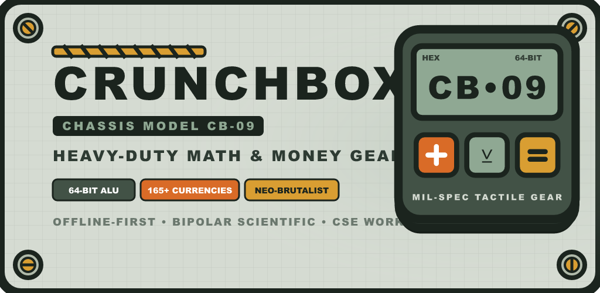

# CRUNCHBOX // CB-09 FIELD UNIT
### Heavy-Duty Math, Money & Systems Engineering Gear
#### "হিসাব ও কারেন্সির রাফ-অ্যান্ড-টাফ গিয়ার"



[](https://github.com/asnayem1122/CrunchBox)
[](https://expo.dev/)
[](https://reactnative.dev/)
[](https://www.typescriptlang.org/)
[-22C55E?style=for-the-badge&logo=jest)](https://jestjs.io/)
[](LICENSE)

---

## 🧰 Overview & Hardware Persona

**CrunchBox (Chassis Model: `CB-09 FIELD UNIT`)** is an industrial-tactile, cartoon-rugged, offline-first calculator, scientific workstation, 165+ currency converter, regional land unit engine, and Computer Science & Engineering (CSE) systems workbench built with **React Native, Expo Router, and TypeScript**.

Inspired by vintage military telemetry equipment and neo-brutalist hardware aesthetics, CrunchBox replaces flimsy modern glass sliders with:
- **3D tactile push-buttons** with springy travel and zero grid jitter.
- **Synthesized 12ms mechanical switch clicks** using pure Web Audio (0ms latency, zero external MP3/WAV assets).
- **Recessed LCD annunciator screen** with 3 tactical backlight modes (*Sage Daylight*, *Amber Field Glow*, *Night-Ops Stealth*).
- **64-bit CSE Systems Workbench** for multi-base radix conversion, hardware ALU flags, IEEE-754 floating point inspection, interactive bit grids, and pure-TS UTF-8 encoding.
- **Regional Bangladeshi Land Math** alongside international SI and Imperial standards.
- **Casio fx-991EX ClassWiz Suite:** Instant $S \Leftrightarrow D$ decimal-to-fraction conversions, `FACT` prime power factorization ($60 = 2^2 \times 3 \times 5$), multiplicative combinatorics ($n\text{C}r$, $n\text{P}r$), and universal physical constants ($c, g, h, N_A, \pi, e$).
- **0ms Speculative Live Auto-Compute:** Displays real-time `ans ≈ ...` previews before pressing equals.
- **Fast History Paper Tape Manager:** Search query filtering, mode tabs (`ALL`, `CALC`, `SCI`, `DEV`, `CURR`, `UNIT`, `TOOLS`), and 4 quick actions (`+ Use Ans`, `✏ Edit Expr`, `📋 Copy`, `★ Pin`).
- **In-App QA Diagnostics & Telemetry:** Built-in hardware telemetry panel and 15-point automated self-test runner.

---

## ⚡ The 6 Operating Modes

```
+===================================================================+
|                    CRUNCHBOX // CB-09 FIELD UNIT                  |
|  [ CALC ]       [ SCI ]        [ DEV ]                            |
|  Basic Math     Trig/Exponents 64b ALU / IEEE-754 / Bit Grid      |
|  ---------------------------------------------------------------- |
|  [ CURR ]       [ UNIT ]       [ TOOLS ]                          |
|  165+ Forex     Regional Units Tip, Tax, Fuel, Compound Interest  |
+===================================================================+
```

### 1. `CALC` — Standard Field Calculator
- Robust Shunting-Yard expression tokenizer supporting unary negation (`-5 + 3`), implicit multiplication (`2π`, `5(2+3)`), postfix percentage (`50 + 10% = 55`), and factorial edge cases (`0! = 1`).
- Stack memory operations: `MC`, `MR`, `M+`, `M-`, and `ANS`.
- Inter-mode bridges: Tap **`SEND TO CURR`** to instantly transfer the evaluated total to the currency converter.

### 2. `SCI` — Scientific Bipolar Engine
- Dual angular modes: **`DEG`** (degrees) and **`RAD`** (radians) reflected in real-time on the LCD annunciator.
- Full trigonometric (`sin`, `cos`, `tan`), hyperbolic (`sinh`, `cosh`, `tanh`), inverse functions (`asin`, `acos`, `atan`), logarithms (`ln`, `log10`), and power operators ($x^y$, $\sqrt{x}$, $x!$).

### 3. `DEV` — CSE Systems & Architecture Workbench
Designed specifically for Computer Science & Engineering students, systems programmers, and low-level engineers:
- **64-bit Multi-Base Radix Engine:** Seamless conversion across `HEX`, `DEC`, `OCT`, and `BIN` with nibble spacing (`1111 0000`) and strict keypad digit locking (invalid keys dimmed and disabled).
- **ALU Logic & Hardware Flags:**
  - Operations: `AND`, `OR`, `XOR`, `NOT`, `NAND`, `NOR`, `XNOR`, `SHL`, `SHR`, `ROR`, `ROL`, and `ENDIAN_SWAP`.
  - Flags: `ZF` (Zero Flag), `SF` (Sign Flag), `CF` (Carry Flag: `null`/`—` on logic ops, accurate on arithmetic), and `OF` (Signed Two's Complement Overflow).
- **IEEE-754 Single-Precision Float Inspector:** Hardware-accurate 32-bit floating point decomposition showing Sign (1b), Exponent (8b), Mantissa (23b), and 32-bit Hex (`-12.375` $\rightarrow$ `0xC1460000`).
- **Interactive 64-bit Bit Grid:** Visual 8-bits-per-row grid with tappable bit flips and bit position labels (`63..0`).
- **Pure-TS Multi-Byte UTF-8 Codec:** Zero-dependency encoder and decoder converting strings to hex/binary byte arrays (supports Unicode and Bengali `'বাংলা'`).
- **Discrete Math:** Modular arithmetic, GCD, LCM, Prime verification with smallest factor, and powers of two.

### 4. `CURR` — 165+ Offline-First Currency Converter
- Priority dual-source rate merging: **Fawaz Ahmed Currency API CDN** (165+ global currencies) overlaid with **Frankfurter ECB** (European Central Bank official rates).
- First-class support for Bangladeshi Taka (`BDT`), Saudi Riyal (`SAR`), UAE Dirham (`AED`), Kuwaiti Dinar (`KWD`), and 160+ others.
- 100% offline-first: Bundled local fallback rates ensure immediate usability in deep field environments with zero network.

### 5. `UNIT` — Multi-Category Unit Converter
- 6 measurement categories: **Length**, **Weight**, **Temperature**, **Speed**, **Volume**, and **Area**.
- **Regional Bangladeshi Land Calculations:**
  - $1\text{ Bigha} = 20\text{ Katha} = 14,400\text{ sq ft} = 1337.80\text{ m}^2$
  - $1\text{ Katha} = 720\text{ sq ft} = 66.89\text{ m}^2$
  - $1\text{ Decimal (শতাংশ)} = 435.6\text{ sq ft} = 40.47\text{ m}^2$
  - $1\text{ Acre} = 100\text{ Decimal} = 4046.86\text{ m}^2$

### 6. `TOOLS` — Everyday Financial Toolkit
- **Tip & Bill Splitter:** Configurable tip percentage, guest count, and per-person breakdown.
- **Discount & Sales Tax:** Original price, discount %, and tax rate with total savings display.
- **Fuel Trip Cost:** Distance, vehicle fuel efficiency (km/L or MPG), and fuel price calculator.
- **Compound Interest & EMI:** Principal, annual rate, time, and compounding frequency.

---

## 🎨 Industrial Tactile Hardware Design

```
+-----------------------------------------------------------+
| [O]  +---------------------------------------------+  [O] |
|      | CALC   * SAGE   INTL   DEG                  |      |
|      |                                             |      |
|      |                                1,337.80     |      |
|      | HEX: 0x539       BIN: 0101 0011 1001        |      |
|      +---------------------------------------------+      |
|                                                           |
|      [ CALC ]            [ SCI ]            [ DEV ]       |
|      [ CURR ]            [ UNIT ]           [ TOOLS ]     |
+-----------------------------------------------------------+
```

1. **Zero-Jitter Tactile Buttons:** Outer wrapper with fixed layout height and static 3D shadow layer; inner keycap face translates down by `3px` on press without causing adjacent keypad rows to jump.
2. **Micro-Annunciator Strip:** LCD display header showing active trig mode (`DEG`/`RAD`), backlight mode (`SAGE`/`AMBR`/`NVG`), number grouping format (`BD`/`INTL`), and live ALU status flags.
3. **Monospace Perforated Paper Tape:** Pull-down receipt drawer with row pinning, tap-to-load memory recall, and ASCII export for receipts:
   ```
   +==================================+
   | CRUNCHBOX // CB-09 FIELD RECEIPT |
   | Unit: CB-09-PROD // 2026-11-01   |
   +----------------------------------+
   | [01] 7 * 8                       |
   |    = 56                          |
   | [02] 0x7F + 1                    |
   |    = 0x80 (ALU: OF=1)            |
   +==================================+
   ```
4. **Bilingual Typography (EN + বাংলা):** Complete synchronous translation with `includeFontPadding: false` and calculated line heights so Bengali vowel markers (ই-কার, ঈ-কার, রেফ) never clip.

---

## 📁 Repository Directory Structure

```
CrunchBox/
├── android/                         # Native Android Gradle project (Prebuild)
│   ├── app/
│   │   ├── build.gradle             # Configured with release signingConfigs
│   │   └── src/main/AndroidManifest.xml
│   └── gradle.properties            # Kotlin 1.9.25, Hermes enabled
├── assets/
│   ├── brand/                       # Master vector source SVGs
│   │   ├── concepts/                # 3 Design concepts (Concept 1 Keycap winner)
│   │   ├── logo-mark.svg            # 1024x1024 master emblem
│   │   ├── adaptive-foreground.svg  # Safe-zone adaptive icon
│   │   ├── adaptive-background.svg  # Putty chassis texture
│   │   └── feature-graphic.svg      # 1024x500 Play Store banner
│   ├── images/                      # Generated PNGs (icon, splash, adaptive)
│   └── store/                       # Play Store launcher and banner PNGs
├── evidence/                        # Verification ledgers & device screenshots
│   ├── QA_LEDGER.md                 # Complete verification matrix & signing info
│   ├── before/                      # Pre-upgrade baseline screenshots
│   ├── after/                       # Device condition matrix screenshots
│   └── release/                     # Standalone release APK & live captures
├── scripts/
│   └── generate-brand-assets.mjs    # Automated @resvg/resvg-js rasterizer
├── src/
│   ├── app/                         # Expo Router screens
│   │   ├── _layout.tsx              # Root layout wrapped in HardwareErrorBoundary
│   │   ├── index.tsx                # Main chassis shell & mode router
│   │   ├── currency-picker.tsx      # Modal search for 165+ currencies
│   │   └── settings.tsx             # Audio, haptic, and backlight settings
│   ├── components/chassis/          # Tactile hardware UI elements
│   │   ├── CrunchBoxLogo.tsx        # Scalable vector logo component
│   │   ├── HardwareErrorBoundary.tsx# CB-09 Fault Recovery screen
│   │   ├── KeypadView.tsx           # Standard & scientific numeric keypad
│   │   ├── LcdDisplay.tsx           # Annunciator strip & responsive LCD
│   │   ├── ModeSelector.tsx         # 2x3 Hardware matrix mode latch
│   │   ├── PaperTapeDrawer.tsx      # Perforated receipt drawer
│   │   ├── RuggedChassis.tsx        # Outer chassis shell with hex screws
│   │   └── TactileButton.tsx        # 3D depressible button component
│   ├── features/                    # Domain math and business logic
│   │   ├── calc/calcEngine.ts       # Shunting-yard expression evaluator
│   │   ├── dev/devEngine.ts         # 64-bit BigInt, ALU flags, IEEE-754, bit grid
│   │   ├── dev/DevView.tsx          # CSE Workbench sub-decks
│   │   ├── exchange-rate/api.ts     # Fawaz + Frankfurter multi-API fetcher
│   │   ├── exchange-rate/rateService.ts # Offline-first rate caching & fallback
│   │   ├── financial/financialFormulas.ts # Tip, tax, fuel, compound formulas
│   │   └── unit-converter/unitDefinitions.ts # SI, Imperial, and BD Land units
│   ├── localization/                # Synchronous bilingual dictionaries
│   │   ├── i18n.ts                  # i18next initialization
│   │   ├── en.json                  # English terminology
│   │   └── bn.json                  # বাংলা অনুবাদ
│   ├── store/useAppStore.ts         # Global Zustand store (persisted, zero-BigInt)
│   └── utils/
│       ├── soundEffects.ts          # Pure Web Audio switch click & haptics
│       ├── themeTokens.ts           # Neo-brutalist palettes & backlight modes
│       └── useHardwareLayout.ts     # Responsive viewport and inset metrics
├── tests/                           # Complete Jest test suite (132 tests)
├── app.json                         # Expo configuration (Package: com.crunchbox.cb09)
├── BRAIN.md                         # Project memory, ADRs & upgrade roadmap
├── CHANGELOG.md                     # Release history (v1.0.0)
├── CONTRIBUTING.md                  # Development guidelines & PR workflow
└── package.json
```

---

## 🚀 Quick Start & Development

### Prerequisites
- **Node.js:** v18+ (tested on Node v20/v24)
- **Java JDK:** OpenJDK 17 (`JAVA_HOME`)
- **Android SDK:** Platform-Tools & Build-Tools 35 (`ANDROID_HOME`)
- **Physical Phone:** Android device with USB Debugging enabled

### 1. Installation
```powershell
git clone https://github.com/asnayem1122/CrunchBox.git
cd CrunchBox
npm install
```

### 2. Run Tests & Typecheck
```powershell
# Strict TypeScript validation
npm run typecheck

# Execute all 132 Jest unit tests across 10 suites
npm test
```

### 3. Connect Physical Android Device over USB
```powershell
# Confirm device shows as "device"
adb devices

# Reverse Metro bundler port
adb reverse tcp:8081 tcp:8081

# Start Metro development server
npm start
```

### 4. Build Standalone Signed Release APK
To compile the standalone APK that runs on Android hardware with zero Metro dependency:
```powershell
cd android

# Compile signed release APK
.\gradlew.bat assembleRelease --project-cache-dir "C:\Users\<username>\AppData\Local\Temp\cb-gradle-cache"

# Install onto connected phone via ADB
adb install -r app/build/outputs/apk/release/app-release.apk

# Launch standalone app on device
adb shell monkey -p com.crunchbox.cb09 -c android.intent.category.LAUNCHER 1
```

---

## 🔒 Security & Release Integrity
- **Package ID:** `com.crunchbox.cb09`
- **Signing Scheme:** Android APK Signature Scheme v2 (Signed with custom PKCS12 keystore)
- **Permissions:** Restricted strictly to `android.permission.INTERNET` (for exchange rate updates) and `android.permission.VIBRATE` (for tactile haptics).
- **Offline Guarantee:** All calculation, scientific, discrete math, unit conversion, and currency operations run 100% offline.
- **Zero Leaked Secrets:** All keystores (`*.jks`), `keystore.properties`, and `local.properties` are strictly excluded from version control via `.gitignore`.

---

## 📜 Architecture Decision Records (ADRs)
Detailed engineering decisions, design trade-offs, and future upgrade roadmaps are comprehensively documented in [**`BRAIN.md`**](BRAIN.md).

---

## 👤 Author & License
- **Author:** [MD. Ahnaf Shahryar Nayem](https://github.com/asnayem1122)
- **License:** [MIT License](LICENSE) (c) 2026 MD. Ahnaf Shahryar Nayem
