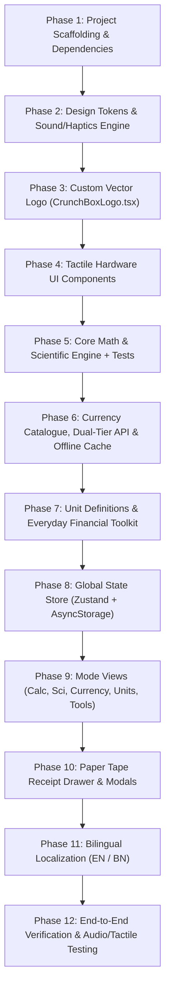

# CrunchBox (CB-09 FIELD UNIT) Implementation Plan

**Goal:** Build "CrunchBox" (Chassis Model: `CB-09 FIELD UNIT`) — a rugged, cartoon-tactile, offline-first multi-mode calculator, scientific engine, 160+ currency converter, unit converter, and financial toolkit in React Native + Expo + TypeScript.  
**Architecture:** Offline-first client-side architecture; Zustand + AsyncStorage persistence; Shunting-Yard math parser; dual-tier CDN/Frankfurter currency cross-rate engine; tactile mechanical push-button physics; bilingual `i18next` (EN & BN).  
**Tech Stack:** React Native, Expo SDK 52+, Expo Router v4, TypeScript (Strict), `react-native-svg`, `lucide-react-native`, Zustand, `@tanstack/react-query`, `i18next`, Web Audio API / `expo-haptics`, Jest.  
**Spec Reference:** `docs/specs/2026-10-31-crunchbox-cb09-design.md`  

---

## Global Constraints & Invariants
- **Strict Offline-First:** Bundled 160+ currency rates embedded in code for day-1 instant offline calculation.
- **Zero-Latency Principle:** Instant 0ms response on every tap. No external cloud delays.
- **Strict Tactility Rules:** Every button, card, and screen has a solid `2.5px`-`3px` ink border (`#1B241E`), 3D depth with `4px`-`5px` solid bottom shadow, and depress on tap.
- **ISO 4217 Decimal Precision:** Exact currency formatting (0 decimals for JPY, 3 for KWD/BHD, 2 for USD/BDT).
- **TypeScript Strict Mode:** No `any` types; all stores, props, tokens, and conversion tables strictly typed.

---

## Agent Orchestration Roles
- **[ROLE: Environment Architect]**: Project scaffolding, Expo Router config, dependencies, asset setup.
- **[ROLE: Brand & Chassis Coder]**: Vector SVG logo (`CrunchBoxLogo.tsx`), theme tokens, `TactileButton`, `LcdDisplay`, `RuggedChassis`.
- **[ROLE: Math & Domain Coder]**: `calcEngine.ts`, `currencyCatalogue.ts`, `unitDefinitions.ts`, `useAppStore.ts`.
- **[ROLE: Feature & View Coder]**: `KeypadView`, `CurrencyView`, `UnitConverterView`, `SmartToolsView`, `PaperTapeDrawer`, modals.
- **[ROLE: Independent Verifier]**: Unit test suite, offline test gate, cross-platform web/native audio & tactile verification.

---

## Dependency Graph & Ordering

---

## Phased Implementation Tasks

### Phase 1: Project Scaffolding & Dependencies
**Files:**
- Create: `package.json`, `app.json`, `tsconfig.json`, `metro.config.js`, `babel.config.js`
- Create: `src/app/_layout.tsx`, `src/app/index.tsx`
- Test: Verify project builds and type-checks cleanly (`npm run tsc` / `npx expo start --web`)

**Tasks:**
- [ ] Initialize Expo app with TypeScript and Expo Router v4.
- [ ] Install dependencies:
  - `expo`, `react-native`, `react-native-web`, `react-dom`, `@expo/metro-runtime`
  - `expo-router`, `react-native-safe-area-context`, `react-native-screens`
  - `react-native-svg`, `lucide-react-native`
  - `zustand`, `@react-native-async-storage/async-storage`
  - `i18next`, `react-i18next`
  - `expo-haptics`, `expo-status-bar`
  - Dev: `typescript`, `@types/react`, `jest`, `ts-jest`, `@types/jest`
- [ ] Configure `app.json` with bundle ID `com.crunchbox.cb09`, app name "CrunchBox", and orientation lock/support.

---

### Phase 2: Design Tokens & Tactile Sound/Haptics Engine
**Files:**
- Create: `src/utils/themeTokens.ts`
- Create: `src/utils/soundEffects.ts`
- Test: `tests/utils/soundEffects.test.ts`

**Interfaces:**
- Consumes: Web Audio API (on Web), `expo-haptics` (on Native).
- Produces: `playMechanicalClick()`, `playTearTapeSound()`, `triggerHaptic()`, theme tokens (`fieldLight`, `tacticalDark`).

**Tasks:**
- [ ] Implement `src/utils/themeTokens.ts` exporting exact color tokens:
  - `appBackground`: `#D8D0C0` / `#0D120F`
  - `chassisSurface`: `#2D5A3C` / `#18261D`
  - `innerPanel`: `#F5F0E1` / `#1F2D24`
  - `keypadSurface`: `#FFFDF7` / `#28382E`
  - `accentOps`: `#EAB308` / `#CA8A04`
  - `dangerRed`: `#D93829` / `#B91C1C`
  - `actionGreen`: `#1E4D2B` / `#2E7D32`
  - `recessedLcd`: `#C5D6A7` / `#132217`
  - `inkBorder`: `#1B241E` / `#070A08`
- [ ] Implement `src/utils/soundEffects.ts`:
  - Synthesize 12ms mechanical switch tone using Web Audio API `AudioContext` with high-pass click decay.
  - Trigger `expo-haptics` on iOS/Android.
  - Graceful fallback when audio is disabled or unsupported.

---

### Phase 3: Custom Vector Logo & Emblem (`CrunchBoxLogo.tsx`)
**Files:**
- Create: `src/components/chassis/CrunchBoxLogo.tsx`
- Test: `tests/components/CrunchBoxLogo.test.ts`

**Interfaces:**
- Produces: `<CrunchBoxLogo variant="icon" | "horizontal" | "stamp" size={number} />`

**Tasks:**
- [ ] Implement `variant="icon"` (120x120 SVG):
  - 3D drop shadow base (`fill="#1B241E"`).
  - Rugged green casing (`#2D5A3C` with 5px ink stroke).
  - 4 corner brass rivets with cross slot screws.
  - Recessed visor LCD (`#C5D6A7`) with monospace `CB•09` and illuminated LED.
  - 2x2 chunky tactile buttons: White (`+`), Cream (`৳`), Red (`×`), Yellow (`=`).
- [ ] Implement `variant="horizontal"`:
  - 36x36 icon paired with heavy uppercase `CRUNCHBOX` nameplate badge and `CB-09` serial tag.
- [ ] Implement `variant="stamp"`:
  - Industrial monochrome stencil badge for paper tape: `VERIFIED BY CRUNCHBOX // FIELD UNIT CB-09`.

---

### 🛑 Checkpoint 1: Visual Foundation & Tokens
- [ ] Project compiles with zero TypeScript errors (`tsc --noEmit`).
- [ ] Sound/Haptics utility initializes without crashes.
- [ ] Logo renders in all 3 variants without clipping or SVG errors.

---

### Phase 4: Tactile Hardware UI Components
**Files:**
- Create: `src/components/ui/TactileButton.tsx`
- Create: `src/components/ui/RuggedCard.tsx`
- Create: `src/components/ui/SwapButton.tsx`
- Create: `src/components/chassis/LcdDisplay.tsx`
- Create: `src/components/chassis/ModeSelector.tsx`
- Create: `src/components/chassis/RuggedChassis.tsx`

**Tasks:**
- [ ] Build `TactileButton.tsx`:
  - Handles 5 button color variants: `number` (White), `operator` (Yellow), `danger` (Red), `action` (Green), `secondary` (Cream).
  - Physical 3D push behavior: on `onPressIn`, `translateY: 3px`, `borderBottomWidth: 2px`; on `onPressOut`, `translateY: 0`, `borderBottomWidth: 5px`.
  - Integrates `playMechanicalClick()`.
- [ ] Build `LcdDisplay.tsx`:
  - Recessed sage-green screen with bevel border and inner depth.
  - Top auxiliary line: Memory badge `[M]`, Angle badge `[DEG/RAD]`, Expression preview.
  - Primary LCD line: Large crisp numbers with dynamic size scaling for long calculations.
  - Bottom auxiliary line: `HEX:`, `BIN:`, `OCT:` live integer representations.
- [ ] Build `ModeSelector.tsx`:
  - 5 tactile toggle tabs: `CALC`, `SCI`, `CURR`, `UNIT`, `TOOLS`.
  - Visual depressed state for active tab.
- [ ] Build `RuggedChassis.tsx`:
  - Outer heavy-duty forest green casing with corner chassis screws, glowing status LED, and top nameplate badge.

---

### Phase 5: Core Math & Scientific Engine
**Files:**
- Create: `src/features/calculator/calcEngine.ts`
- Test: `tests/features/calcEngine.test.ts`

**Interfaces:**
- Produces: `evaluateExpression(expr: string, angleMode: 'deg' | 'rad'): { result: number; error?: string }`, `toHexBinOct(val: number): { hex: string; bin: string; oct: string }`, `formatCalcNumber(val: number): string`.

**Tasks:**
- [ ] Implement tokenization for numbers, operators (`+`, `-`, `×`, `÷`, `%`, `^`), parentheses, and constants ($\pi, e$).
- [ ] Implement Shunting-Yard conversion to Reverse Polish Notation (RPN).
- [ ] Implement RPN evaluator with support for:
  - Basic arithmetic and percentage calculations.
  - Scientific functions: `sin`, `cos`, `tan`, `asin`, `acos`, `atan` (respecting `deg` vs `rad`), `log` (base 10), `ln`, `sqrt`, `cbrt`, factorials (`n!`), powers ($x^2, x^3, 10^x, e^x, x^y$).
  - Floating-point drift correction (`Math.round(val * 1e12) / 1e12`).
  - Safe error handling (Division by zero, negative square roots $\rightarrow$ display `ERROR`).
- [ ] Implement `toHexBinOct(val)` for auxiliary LCD integer representations.
- [ ] Write comprehensive unit tests in `tests/features/calcEngine.test.ts` verifying all operations.

---

### 🛑 Checkpoint 2: Math Engine Verification
- [ ] Run `npm test tests/features/calcEngine.test.ts` $\rightarrow$ 100% pass.
- [ ] All edge cases (division by zero, factorial of 0, $\sin(90^\circ)$, large numbers) pass verified assertions.

---

### Phase 6: Currency Engine (160+ Currencies & Offline First)
**Files:**
- Create: `src/features/currency/currencyCatalogue.ts`
- Create: `src/features/currency/bundledRates.ts`
- Create: `src/services/exchange-rate/rateService.ts`
- Create: `src/services/exchange-rate/api.ts`
- Create: `src/services/exchange-rate/cache.ts`
- Create: `src/utils/formatCurrency.ts`
- Test: `tests/features/rateService.test.ts`, `tests/utils/formatCurrency.test.ts`

**Tasks:**
- [ ] Create `currencyCatalogue.ts` with 165+ currencies:
  - Code (e.g. `BDT`, `USD`, `EUR`, `KWD`, `JPY`), Symbol (৳, $, €, KD, ¥), Flag, English Name, Bengali Name, Country Name, Decimal Digits (0 for JPY, 3 for KWD/BHD/OMR, 2 for others).
- [ ] Create `bundledRates.ts` containing offline baseline USD rates for all 165+ currencies.
- [ ] Build `formatCurrency.ts` implementing ISO 4217 decimal formatting and locale-aware number groups.
- [ ] Build `rateService.ts`:
  - `convertCurrency(amount, fromCode, toCode, rates)` via triangular cross-rate: $\text{amount} \times (\text{rate}[\text{to}] / \text{rate}[\text{from}])$.
  - Handles zero amount, invalid currencies, and precision formatting.
- [ ] Build `api.ts` with dual-tier fallback:
  - Tier 1: `https://cdn.jsdelivr.net/npm/@fawazahmed0/currency-api@latest/v1/currencies/usd.json`
  - Tier 2 fallback: `https://latest.currency-api.pages.dev/v1/currencies/usd.json`
  - Tier 3 fallback: `https://api.frankfurter.dev/v1/latest?base=USD`
  - AsyncStorage persistence via `cache.ts` with 24-hour stale flag.

---

### Phase 7: Multi-Category Unit Converter & Financial Toolkit
**Files:**
- Create: `src/features/units/unitDefinitions.ts`
- Create: `src/features/tools/financialFormulas.ts`
- Test: `tests/features/unitDefinitions.test.ts`, `tests/features/financialFormulas.test.ts`

**Tasks:**
- [ ] Implement `unitDefinitions.ts` across 6 categories:
  - Length (mm, cm, m, km, in, ft, yd, mi)
  - Weight (mg, g, kg, t, oz, lb, st)
  - Temperature (Celsius, Fahrenheit, Kelvin with affine conversion)
  - Area ($m^2$, $ft^2$, $yd^2$, acre, hectare, bigha)
  - Data Storage (B, KB, MB, GB, TB, PB)
  - Speed (km/h, mph, m/s, knots)
  - Bidirectional conversion function: `convertUnits(val, fromUnit, toUnit, category)`.
- [ ] Implement `financialFormulas.ts`:
  - `calculateTipAndSplit(bill, tipPercent, numGuests)`
  - `calculateDiscountAndTax(originalPrice, discountPercent, taxPercent)`
  - `calculateLoanEmi(principal, annualRatePercent, tenureMonths)`
  - `calculateBmi(weightKg, heightCm)`

---

### Phase 8: Global State Store (Zustand + AsyncStorage)
**Files:**
- Create: `src/store/useAppStore.ts`
- Test: `tests/store/useAppStore.test.ts`

**Tasks:**
- [ ] Define `AppState` schema with persistence key `@crunchbox_cb09_store`.
- [ ] Manage active mode (`calc`, `sci`, `curr`, `unit`, `tools`), theme (`field` / `tactical`), language (`en` / `bn`), sound & haptic toggles.
- [ ] Manage calculator buffer, memory, paper tape history (up to 100 entries).
- [ ] Manage currency selected pairs (`USD` / `BDT` default), saved quick pairs, exchange rates cache.
- [ ] Manage unit converter selections.
- [ ] Provide actions: `inputKey()`, `calculateResult()`, `clearAll()`, `deleteKey()`, `swapCurrencies()`, `starPair()`, `tearTape()`, `recallTapeEntry()`.

---

### 🛑 Checkpoint 3: Domain Logic & Store Integration
- [ ] All unit test suites pass (`calcEngine`, `rateService`, `unitDefinitions`, `financialFormulas`, `useAppStore`).
- [ ] State persistence roundtrips properly without data corruption.

---

### Phase 9: Feature Views & Keypad Layouts
**Files:**
- Create: `src/features/calculator/KeypadView.tsx`
- Create: `src/features/currency/CurrencyView.tsx`
- Create: `src/features/currency/CurrencyCard.tsx`
- Create: `src/features/currency/PopularChips.tsx`
- Create: `src/features/currency/RateBadge.tsx`
- Create: `src/features/units/UnitConverterView.tsx`
- Create: `src/features/tools/SmartToolsView.tsx`

**Tasks:**
- [ ] Implement `KeypadView.tsx`:
  - Standard 4x5 tactile button grid (`C/AC`, `DEL`, `(`, `)`, `÷`, `7-9`, `×`, `4-6`, `-`, `1-3`, `+`, `0`, `.`, `=`).
  - Collapsible/Switchable Scientific panel with 5 columns (`sin`, `cos`, `tan`, `DEG/RAD`, `π`, `ln`, `log`, `x²`, `x^y`, `e`, `√`, `n!`, `1/x`, `M+`, `MR`).
- [ ] Implement `CurrencyView.tsx`:
  - Tactile "YOU SEND" and "YOU RECEIVE" `CurrencyCard` components.
  - Animated `SwapButton` with 180° rotation on tap.
  - Popular chips bar (`BDT`, `USD`, `EUR`, `GBP`, `AED`, `SAR`, `INR`).
  - Saved currency pairs list with 1-tap recall.
  - `RateBadge` showing effective exchange rate date and offline stale warning if >24 hours.
- [ ] Implement `UnitConverterView.tsx`:
  - 6-category horizontal tab bar with icons.
  - "FROM" and "TO" unit pickers + numeric input deck with instant swap.
- [ ] Implement `SmartToolsView.tsx`:
  - Sub-tabs: `TIP & SPLIT`, `DISCOUNT & TAX`, `LOAN EMI`, `BMI GAUGE`.
  - Tactile numeric sliders, increment/decrement steppers, and clear summary receipts.

---

### Phase 10: Perforated Paper Tape Drawer & Modals
**Files:**
- Create: `src/components/chassis/PaperTapeDrawer.tsx`
- Create: `src/app/currency-picker.tsx`
- Create: `src/app/settings.tsx`

**Tasks:**
- [ ] Implement `PaperTapeDrawer.tsx`:
  - Slide-out bottom sheet styled like an industrial cash-register receipt with perforated zig-zag edge SVG.
  - Displays calculation log with timestamps and mode tags.
  - Tap-to-recall loads past results into active calculator.
  - `TEAR TAPE` button to clear history.
  - Industrial monochrome stencil stamp at bottom: `CrunchBoxLogo (variant="stamp")`.
- [ ] Implement `currency-picker.tsx`:
  - Modal route with instant real-time search filtering across 165+ currencies by Code, English Name, Bengali Name, and Country.
  - Flags and currency symbols displayed with tactile selection indicator.
- [ ] Implement `settings.tsx`:
  - Brand Hero Card with `CrunchBoxLogo (variant="icon")` and hardware nameplate `CRUNCHBOX // CB-09`.
  - Field Light Mode vs Tactical Dark Mode toggle.
  - English vs বাংলা (`en` / `bn`) language switcher.
  - Tactile audio & haptic toggle switches.
  - Offline cache status: Rates count, last updated timestamp, and "FORCE REFRESH RATES" button.
  - Version info & hardware persona serial badge.

---

### Phase 11: Bilingual Localization (EN & BN)
**Files:**
- Create: `src/localization/i18n.ts`
- Create: `src/localization/en.json`
- Create: `src/localization/bn.json`

**Tasks:**
- [ ] Complete English localization with rugged hardware terminology.
- [ ] Complete Bengali localization (`হিসাব`, `সায়েন্টিফিক`, `কারেন্সি`, `একক রূপান্তর`, `টুলস`, `কাগজের রসিদ`, `টাকা পাঠান`, `টাকা পাবেন`, etc.).
- [ ] Wire dynamic language switching in `useAppStore` $\rightarrow$ `i18n.changeLanguage(lang)`.

---

### Phase 12: End-to-End Polish, Audio/Tactile Testing & Verification
**Files:**
- Modify: `src/app/index.tsx`
- Test: Build tests, full cross-platform checks on Web and Mobile simulators.

**Tasks:**
- [ ] Wire the 5 modes into the main chassis index view with smooth transitions.
- [ ] Verify 3D mechanical button depression on tap across all screens.
- [ ] Verify Web Audio mechanical switch click tone and `expo-haptics`.
- [ ] Run automated unit test suites (`npm test`).
- [ ] Verify zero console errors, zero layout shifts, and full responsiveness across mobile and desktop browser viewports.

---

## Plan Self-Review Checklist
- [x] **Spec coverage**: Every feature from `docs/specs/2026-10-31-crunchbox-cb09-design.md` maps directly to an explicit task.
- [x] **Step scan**: Each step performs a single verifiable action.
- [x] **Type consistency**: Store types, currency models, and theme tokens are unified across all modules.
- [x] **Proportion**: Sized into bite-sized verifiable tasks with explicit test checkpoints.
- [x] **Preservation**: Empty repository clean-slate creation; no existing files overwritten.
