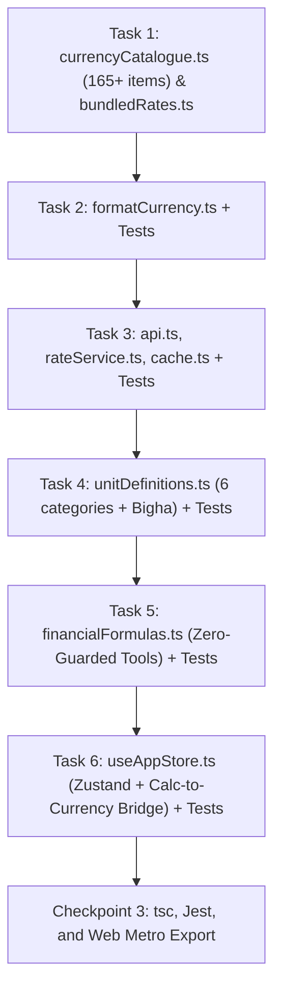

# CrunchBox CB-09 — Sprint 3 Implementation Plan

**Goal:** Implement the complete domain logic and state layer: 165+ Offline-First Currency Engine (Phase 6), Multi-Category Unit Converter & Financial Toolkit (Phase 7), and SSR-Safe Global Zustand Store with Calc-to-Currency Bridge (Phase 8).  
**Architecture:** Client-side offline-first architecture; priority-merged dual-tier currency pipeline (`bundledRates` -> `fawazahmed0` CDN -> `Frankfurter` overlay); triangular cross-rates with ISO 4217 decimal formatting; affine temperature transformations & South Asian land units (Bigha, Katha, Decimal); compound-loan zero-interest guards; SSR-safe persistent Zustand store with paper tape history.  
**Tech Stack:** TypeScript (Strict), Zustand (`persist`), AsyncStorage, `Intl.NumberFormat`, Jest/ts-jest, Expo Web Metro Bundler.  
**Spec Reference:** [`docs/specs/2026-10-31-crunchbox-cb09-design.md`](file:///d:/Code/CrunchBox/docs/specs/2026-10-31-crunchbox-cb09-design.md)  

---

## Global Constraints & Invariants for Sprint 3
1. **Uppercase Normalization & Merging Invariant:**
   - Fawazahmed0 returns lowercase currency codes (`usd.bdt`, `usd.eur`). All keys MUST be mapped to uppercase (`code.toUpperCase()`), filtered for finite positive numbers (`typeof val === 'number' && val > 0`), and merged in strict order:
     `{ ...BUNDLED_RATES_USD, ...normalizedFawazRates, ...normalizedFrankfurterRates, USD: 1 }`.
   - Never overwrite the 165+ currency catalogue with Frankfurter's 32-currency subset.
2. **ISO 4217 Decimal Precision:**
   - 0 decimals: `JPY`, `KRW`, `VND`, `IDR`, `CLP`, `HUF`, `ISK`, `PYG`, `UGX`, `RWF`.
   - 3 decimals: `KWD`, `BHD`, `OMR`, `JOD`, `TND`, `IQD`, `LYD`.
   - 2 decimals: `BDT`, `USD`, `EUR`, `GBP`, `INR`, `CAD`, `AUD`, `CHF`, etc.
3. **South Asian Land Units & Exact Affine Temp:**
   - Regional area units: Bigha (`1337.803776 m²` / `14,400 sq ft`), Katha (`66.8901888 m²` / `720 sq ft`), and Decimal/Shotangsho (`40.468564224 m²` / `435.6 sq ft`).
   - Exact affine conversion for temperatures across Celsius ($C$), Fahrenheit ($F$), and Kelvin ($K$).
4. **Zero-Interest & Zero-Input Guard Invariants:**
   - In `calculateLoanEmi`: If `annualRatePercent === 0`, return `monthlyEmi = principal / tenureMonths` (never `0/0 = NaN`).
   - In `calculateTipAndSplit`: Clamp `numGuests` to $\ge 1$.
   - In `calculateBmi`: Return `'unknown'` or safe object if height/weight $\le 0$.
5. **SSR & Test-Safe AsyncStorage Persistence:**
   - Custom `createJSONStorage` adapter that falls back to in-memory storage when `typeof window === 'undefined'` or in Jest test runners.
   - Zero `// TODO` placeholders; 100% strict TypeScript types.

---

## Dependency Graph for Sprint 3



---

## Detailed Task Breakdown

### Task 1: 165+ ISO 4217 Currency Catalogue & Bundled Offline Rates
**Files:**
- Create: `src/features/currency/currencyCatalogue.ts`
- Create: `src/features/currency/bundledRates.ts`

**Interfaces:**
- Produces:
  ```typescript
  export interface CurrencyInfo {
    code: string;
    symbol: string;
    flag: string;
    nameEn: string;
    nameBn: string;
    country: string;
    decimals: number;
  }
  export const CURRENCY_CATALOGUE: Record<string, CurrencyInfo>;
  export const CURRENCY_LIST: CurrencyInfo[];
  export const BUNDLED_RATES_USD: Record<string, number>;
  export const POPULAR_CURRENCY_CODES: string[]; // ['BDT', 'USD', 'EUR', 'GBP', 'AED', 'SAR', 'INR']
  ```

**Steps:**
1. Author `currencyCatalogue.ts` containing 165+ currencies with ISO codes, country flags, English and native Bengali names (e.g., `BDT`: "বাংলাদেশি টাকা", `USD`: "মার্কিন ডলার", `EUR`: "ইউরো", `SAR`: "সৌদি রিয়াল", `AED`: "ইউএই দিরহাম", `KWD`: "কুয়েতি দিনার", `INR`: "ভারতীয় রুপি", etc.), and correct decimals (`0` for JPY/KRW, `3` for KWD/BHD/OMR, `2` for others).
2. Author `bundledRates.ts` mapping every currency in the catalogue to baseline rates against `USD = 1.0` (with accurate baseline values such as `BDT: 124.11`, `EUR: 0.92`, `GBP: 0.77`, `AED: 3.6725`, `SAR: 3.75`, `INR: 84.05`, `KWD: 0.307`, `JPY: 153.2`, etc.) to guarantee 0ms instant cold-start operation.

---

### Task 2: Precision ISO Decimal Formatter (`formatCurrency.ts`) & Unit Tests
**Files:**
- Create: `src/utils/formatCurrency.ts`
- Create: `tests/utils/formatCurrency.test.ts`

**Interfaces:**
- Consumes: `CURRENCY_CATALOGUE`
- Produces:
  ```typescript
  export function formatCurrencyAmount(amount: number, currencyCode: string, locale?: string): string;
  export function getCurrencyDecimals(currencyCode: string): number;
  export function parseCurrencyInput(input: string, currencyCode: string): number;
  ```

**Steps:**
1. Implement `getCurrencyDecimals` returning 0 for JPY, 3 for KWD/BHD/OMR, 2 for BDT/USD.
2. Implement `formatCurrencyAmount` using native `Intl.NumberFormat` with strict minimum and maximum fraction digits corresponding to the currency's ISO definition.
3. Write `tests/utils/formatCurrency.test.ts` verifying formatting for JPY (`¥1,500`), KWD (`KD 12.345`), and BDT (`৳ 1,420.50`).

---

### Task 3: Dual-Tier Exchange Rate API, Normalization & Cross-Rate Engine
**Files:**
- Create: `src/services/exchange-rate/cache.ts`
- Create: `src/services/exchange-rate/api.ts`
- Create: `src/services/exchange-rate/rateService.ts`
- Create: `tests/features/rateService.test.ts`

**Interfaces:**
- Produces:
  ```typescript
  export interface ExchangeRatePayload {
    rates: Record<string, number>;
    effectiveDate: string;
    fetchedAt: number;
    source: 'live' | 'cache' | 'bundled';
    isStale: boolean;
  }
  export async function fetchExchangeRates(): Promise<ExchangeRatePayload>;
  export function convertCurrency(amount: number, fromCode: string, toCode: string, rates: Record<string, number>): number;
  export function mergeRates(bundled: Record<string, number>, fawaz?: Record<string, number>, frankfurter?: Record<string, number>): Record<string, number>;
  ```

**Steps:**
1. Implement `api.ts`:
   - Fetch primary from `https://cdn.jsdelivr.net/npm/@fawazahmed0/currency-api@latest/v1/currencies/usd.json`.
   - Fallback 1: `https://latest.currency-api.pages.dev/v1/currencies/usd.json`.
   - Fallback 2 / Supplemental: `https://api.frankfurter.dev/v1/latest?base=USD`.
   - Normalize lowercase keys to uppercase, filter finite numbers $> 0$.
   - Merge: `{ ...BUNDLED_RATES_USD, ...fawazRates, ...frankfurterRates, USD: 1 }`.
   - Save to AsyncStorage via `cache.ts`.
2. Implement `rateService.ts`:
   - `amount * (rates[toCode] / rates[fromCode])`.
   - Triangular cross-rates with guard against missing/zero rates.
3. Write `tests/features/rateService.test.ts` verifying cross conversions (`USD -> BDT`, `EUR -> BDT`, `JPY -> KWD`), rate merging priority, and uppercase normalization.

---

### Task 4: Multi-Category Unit Converter with South Asian Land Units
**Files:**
- Create: `src/features/units/unitDefinitions.ts`
- Create: `tests/features/unitDefinitions.test.ts`

**Interfaces:**
- Produces:
  ```typescript
  export type UnitCategory = 'LENGTH' | 'WEIGHT' | 'TEMP' | 'AREA' | 'DATA' | 'SPEED';
  export interface UnitDef {
    id: string;
    nameEn: string;
    nameBn: string;
    symbol: string;
    toBase: (val: number) => number;
    fromBase: (baseVal: number) => number;
  }
  export function convertUnitValue(value: number, fromUnitId: string, toUnitId: string, category: UnitCategory): number;
  ```

**Steps:**
1. Implement 6 categories:
   - `LENGTH`: mm, cm, m, km, in, ft, yd, mi.
   - `WEIGHT`: mg, g, kg, t, oz, lb, st.
   - `TEMP`: Celsius, Fahrenheit, Kelvin with exact affine formulas.
   - `AREA`: $m^2$, $ft^2$, $yd^2$, Acre, Hectare, **Bigha** (`1337.803776 m²`), **Katha** (`66.8901888 m²`), **Decimal / Shotangsho** (`40.468564224 m²`).
   - `DATA`: B, KB, MB, GB, TB, PB (1024 base).
   - `SPEED`: km/h, mph, m/s, knots.
2. Write unit tests in `tests/features/unitDefinitions.test.ts` verifying all 6 categories, including `1 Bigha = 20 Katha`, `1 Katha = 16 Decimal / Shotangsho`, and $0^\circ C = 32^\circ F = 273.15 K$.

---

### Task 5: Zero-Guarded Financial Formulas
**Files:**
- Create: `src/features/tools/financialFormulas.ts`
- Create: `tests/features/financialFormulas.test.ts`

**Interfaces:**
- Produces:
  ```typescript
  export function calculateLoanEmi(principal: number, annualRatePercent: number, tenureMonths: number): {
    monthlyEmi: number;
    totalInterest: number;
    totalPayment: number;
  };
  export function calculateTipAndSplit(bill: number, tipPercent: number, numGuests: number): {
    tipAmount: number;
    totalBill: number;
    perPersonTotal: number;
    perPersonTip: number;
  };
  export function calculateDiscountAndTax(originalPrice: number, discountPercent: number, taxPercent: number): {
    discountAmount: number;
    priceAfterDiscount: number;
    taxAmount: number;
    finalPrice: number;
    totalSavings: number;
  };
  export function calculateBmi(weightKg: number, heightCm: number): {
    bmi: number;
    category: 'underweight' | 'normal' | 'overweight' | 'obese' | 'unknown';
  };
  ```

**Steps:**
1. Implement `calculateLoanEmi` with mandatory rule #4: If `annualRatePercent === 0`, return `monthlyEmi = principal / tenureMonths`. Guard against $\le 0$ principal/tenure.
2. Implement `calculateTipAndSplit` clamping `numGuests` to $\ge 1$.
3. Implement `calculateDiscountAndTax` with precision rounding.
4. Implement `calculateBmi` guarding non-positive values.
5. Write `tests/features/financialFormulas.test.ts` covering 0% loan interest, negative inputs, guest count clamping, and standard formulas.

---

### Task 6: SSR-Safe Persistent Zustand Store with Calc-to-Currency Bridge
**Files:**
- Create: `src/store/useAppStore.ts`
- Create: `tests/store/useAppStore.test.ts`

**Interfaces:**
- Produces:
  ```typescript
  export interface PaperTapeEntry {
    id: string;
    timestamp: number;
    expression: string;
    result: string;
    mode: HardwareMode;
  }
  export interface AppState {
    activeMode: HardwareMode;
    themeMode: ThemeMode;
    language: 'en' | 'bn';
    soundEnabled: boolean;
    hapticsEnabled: boolean;
    // Calculator
    calcExpression: string;
    calcResult: string;
    calcMemory: number;
    angleMode: AngleMode;
    paperTape: PaperTapeEntry[];
    // Currency
    fromCurrency: string;
    toCurrency: string;
    currencyAmount: string;
    exchangeRates: Record<string, number>;
    ratesEffectiveDate: string;
    ratesFetchedAt: number;
    ratesSource: 'live' | 'cache' | 'bundled';
    ratesStale: boolean;
    favoriteCurrencyPairs: Array<{ from: string; to: string }>;
    // Units
    unitCategory: UnitCategory;
    fromUnit: string;
    toUnit: string;
    unitAmount: string;
    // Actions
    setMode: (mode: HardwareMode) => void;
    toggleTheme: () => void;
    setLanguage: (lang: 'en' | 'bn') => void;
    setCalcExpression: (expr: string) => void;
    setCalcResult: (res: string) => void;
    addPaperTapeEntry: (entry: Omit<PaperTapeEntry, 'id' | 'timestamp'>) => void;
    tearTape: () => void;
    recallTapeEntry: (id: string) => void;
    setCurrencies: (from: string, to: string) => void;
    swapCurrencies: () => void;
    setCurrencyAmount: (amount: string) => void;
    toggleFavoritePair: (from: string, to: string) => void;
    sendCalcToCurrency: () => void; // Mandatory Rule #5 Bridge
    refreshRates: () => Promise<void>;
  }
  ```

**Steps:**
1. Configure SSR-safe `AsyncStorage` wrapper with key `@crunchbox_cb09_store`.
2. Implement all actions, including `sendCalcToCurrency()` which evaluates current expression if needed, strips any non-numeric error characters, sets `currencyAmount` to positive value, and switches `activeMode` to `'CURR'`.
3. Implement `paperTape` management capped at 50 entries with `tearTape()` and `recallTapeEntry()`.
4. Write `tests/store/useAppStore.test.ts` verifying initial state, `sendCalcToCurrency()`, currency swapping, paper tape history, and persistence.

---

### 🛑 Checkpoint 3 Verification Criteria
1. `tsc --noEmit` exits with 0 errors.
2. `npm test` runs all test suites (`rateService`, `formatCurrency`, `unitDefinitions`, `financialFormulas`, `useAppStore`, `calcEngine`, `CrunchBoxLogo`, `soundEffects`) with 100% pass rate.
3. `npx expo export -p web` compiles and statically exports with zero bundling errors.
