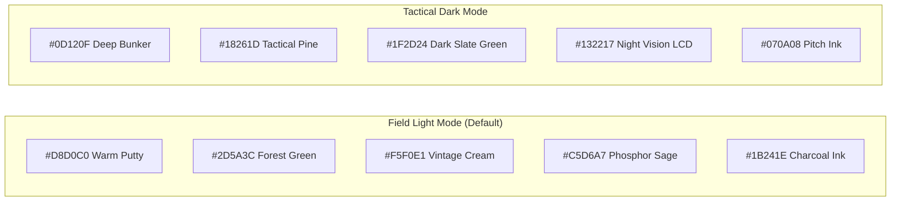
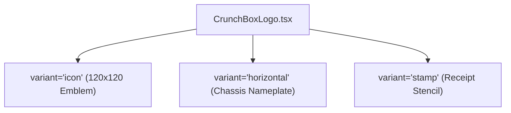
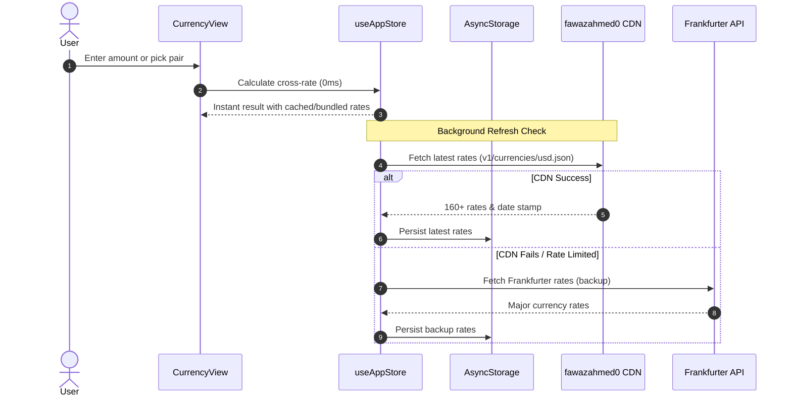

# CrunchBox (CB-09 FIELD UNIT) Design Specification

**Status:** Approved Architecture & Specification  
**Chassis Model:** `CB-09 FIELD UNIT`  
**Package ID:** `com.crunchbox.cb09`  
**Date:** 2026-10-31  
**Author:** Principal Cross-Platform Application Architect & UI Engineer  

---

## 1. Problem Statement & Mission Framing

> **How Might We** engineer a zero-latency, 100% offline-capable, cross-platform calculation and currency instrument that replaces sterile, generic utility apps with a high-tactility, cartoon-rugged "heavy-duty field gear" physical hardware aesthetic?

### 1.1 Core Value Proposition & Persona
Most mobile calculators and currency converters feel like soulless, disposable digital utility screens loaded with ads, subscription paywalls, forced logins, or fragile cloud dependencies. **CrunchBox (CB-09 Field Unit)** is engineered with the soul of a field-rugged military-grade pocket instrument—combining the tactile joy of mechanical switches, physical corner rivets, and an industrial recessed sage-green LCD with instant 0ms calculation, 160+ currency conversion, precision unit translation, and everyday financial problem solvers.

- **English Tagline:** "Heavy-Duty Math & Money Gear"
- **Bengali Tagline:** "হিসাব ও কারেন্সির রাফ-অ্যান্ড-টাফ গিয়ার"
- **Zero-Friction Invariant:** Open app $\rightarrow$ Tap or enter $\rightarrow$ See instant result in 0ms. No splash-screen delays, no user account, no cloud servers.

---

## 2. 7-Lens Divergent Ideation & Convergent Synthesis

During architectural brainstorming, we expanded the concept through 7 critical lenses to stress-test every design decision:

| Lens | Divergent Exploration | Convergent Decision for CB-09 |
| :--- | :--- | :--- |
| **1. Inversion** | What if there were no digital buttons, only speech or text commands? | **Rejected:** Tactility is the product. We double down on hyper-physical 3D mechanical push buttons that visibly depress by 3px with hard ink shadows and trigger mechanical switch audio/haptics. |
| **2. Constraint Removal** | What if unlimited cloud compute and live streaming market data were available? | **Controlled:** CrunchBox must function 10,000 feet in the air or deep inside a concrete bunker. We bundle full 160+ currency fallback rates directly in the app binary and use AsyncStorage offline caching. |
| **3. Audience Shift** | How would a field engineer, trader, student, or local shopkeeper in Dhaka or New York use this? | **Bilingual Native:** Full English and বাংলা (`bn`) support with Bengali numerals and currency formatting (টাকা ৳ / $ / € / £). |
| **4. Combination** | What if we combine a calculator, tape receipt, unit converter, and currency exchange into one cohesive hardware deck? | **Hardware Mode Deck:** 5 tactile mode toggle tabs (`CALC`, `SCI`, `CURR`, `UNIT`, `TOOLS`) mounted directly below the recessed LCD screen, sharing unified tactile input and memory. |
| **5. Simplification (Ponytail)** | What is the 10x simpler, bloat-free implementation? | **Zero Backend / Zero Heavy Libs:** Eliminate Math.js (which adds ~500KB bundle bloat) in favor of a lean, custom, recursive-descent parser; eliminate sound asset files in favor of synthesized Web Audio API clicks. |
| **6. 10x Scale** | What if the user does 1,000 rapid calculations during inventory auditing? | **Perforated Paper Tape Drawer:** Pull-out industrial receipt drawer that logs every operation with timestamps, stenciled verification stamp, and tap-to-recall. |
| **7. Expert Lens** | What do professional accountants and currency traders demand? | **Strict ISO 4217 Decimal Precision:** Zero-decimal formatting for JPY/KRW, three-decimal precision for KWD/BHD/OMR, and live cross-rate calculations with effective-date badges. |

---

## 3. Visual Design System & Tactile Tokens

CrunchBox CB-09 enforces a **Neo-Brutalist Tactile Hardware Aesthetic** (heavy ink outlines, physical push-buttons with hard bottom-offset shadows, recessed visor display, and brass corner screws).

### 3.1 Color Palette Matrix



| Token Role | Field Light Mode (Default) | Tactical Dark Mode | Functional Usage |
| :--- | :--- | :--- | :--- |
| **`appBackground`** | `#D8D0C0` (Warm Putty) | `#0D120F` (Deep Bunker) | Outer viewport background |
| **`chassisSurface`**| `#2D5A3C` (Forest Green) | `#18261D` (Tactical Pine) | Outer rugged unit casing |
| **`innerPanel`**    | `#F5F0E1` (Vintage Cream) | `#1F2D24` (Dark Slate Green) | Cards, paper tape & sub-decks |
| **`keypadSurface`** | `#FFFDF7` (Crisp White) | `#28382E` (Charcoal Moss) | Number keys (`0-9`, `.`) |
| **`accentOps`**     | `#EAB308` (Mustard Gold) | `#CA8A04` (Amber Gold) | Operators (`+`, `-`, `×`, `÷`) |
| **`dangerRed`**     | `#D93829` (Brick Crimson) | `#B91C1C` (Deep Crimson) | `AC`, `DEL`, Reset |
| **`actionGreen`**   | `#1E4D2B` (Deep Turf Green)| `#2E7D32` (Field Emerald) | Equals (`=`), Execute |
| **`recessedLcd`**   | `#C5D6A7` (Phosphor Sage) | `#132217` (Night Vision LCD) | LCD display panel background |
| **`inkBorder`**     | `#1B241E` (Charcoal Ink) | `#070A08` (Pitch Ink) | 2.5px-3px borders & hard shadows |

### 3.2 Mechanical Switch Physics (Tactile Hardware Rules)
1. **Borders:** Every card, button, display bezel, and input surface has a solid `2.5px` to `3px` border (`#1B241E`).
2. **3D Key Push Depth:**
   - **Resting state:** `translateY: 0`, `borderBottomWidth: 5px`, `boxShadow: 0 4px 0 #1B241E`.
   - **Pressed state (`onPressIn`):** `translateY: 3px`, `borderBottomWidth: 2px`, `boxShadow: 0 1px 0 #1B241E`.
   - **Release (`onPressOut`):** Springs back smoothly to resting height.
3. **Tactile Feedback:**
   - **Native (iOS/Android):** `expo-haptics` triggers `impactAsync(ImpactFeedbackStyle.Light)` on every press.
   - **Web:** Synthetic Web Audio API oscillator generates an authentic 12ms mechanical switch click tone (zero mp3 assets needed).

---

## 4. Custom Vector Logo & Emblem (`CrunchBoxLogo.tsx`)

The vector logo is implemented as a standalone, zero-dependency SVG component at `src/components/chassis/CrunchBoxLogo.tsx` providing three variants:



1. **`variant="icon"` (120x120 Emblem):**
   - **Drop Shadow:** Rounded rect `x="10" y="14" width="104" height="100" rx="22" fill="#1B241E"`.
   - **Casing:** Rounded rect `x="8" y="8" width="104" height="100" rx="22" fill="#2D5A3C" stroke="#1B241E" strokeWidth="5"`.
   - **4 Rivets:** Screws at `(20,20)`, `(100,20)`, `(20,96)`, `(100,96)` filled with `#F5F0E1` and `#1B241E` cross slots.
   - **LCD Visor:** `x="20" y="20" width="80" height="28" rx="7" fill="#C5D6A7" stroke="#1B241E" strokeWidth="4"`, monospace text `CB•09` and illuminated red/green LED dot.
   - **2x2 Keycap Grid:**
     - Top-Left: Crisp White (`#FFFDF7`) with `+` glyph.
     - Top-Right: Vintage Cream (`#F5F0E1`) with `৳` / `$` currency glyph.
     - Bottom-Left: Brick Crimson (`#D93829`) with `×` glyph.
     - Bottom-Right: Mustard Yellow (`#EAB308`) with `=` glyph.
2. **`variant="horizontal"`:**
   - Miniature 36x36 emblem paired with an industrial metal nameplate badge: `CRUNCHBOX // CB-09` in heavy geometric uppercase tracking with rivet pins and a status LED.
3. **`variant="stamp"`:**
   - Monochrome stenciled ink stamp (`#1B241E` at 65% opacity) reading: `VERIFIED BY CRUNCHBOX // FIELD UNIT CB-09`.

---

## 5. Architectural Subsystems

### 5.1 Calculator & Scientific Engine (`calcEngine.ts`)
- **Lightweight Parser:** Zero external dependencies. Uses a tokenized Shunting-Yard algorithm and recursive-descent evaluation.
- **Operations:** Addition, subtraction, multiplication, division, modulo, exponentiation ($x^y$), parentheses.
- **Scientific Functions:** Trigonometric (`sin`, `cos`, `tan`, `asin`, `acos`, `atan` with DEG/RAD switch), logarithms (`log10`, `ln`), powers (`x²`, `x³`, `10^x`, `e^x`), square root ($\sqrt{x}$), factorials ($n!$), constants ($\pi, e$).
- **Precision Guard:** Automatic rounding of floating-point drift (e.g., $0.1 + 0.2 = 0.3$, $\sin(\pi) = 0$).
- **Base Converter:** Instant calculation of current integer result into Hexadecimal (`HEX`), Binary (`BIN`), and Octal (`OCT`) displayed on the LCD auxiliary strip.
- **Memory Register:** Full support for `MC`, `MR`, `M+`, `M-` with an active `[M]` indicator illuminated on the LCD display.

### 5.2 160+ Offline-First Currency Engine

- **Catalogue:** 165+ world currencies with country codes, flags, symbols, native English and Bengali names, and strict ISO 4217 decimal formatting rules (0 decimals for JPY, 3 decimals for KWD/BHD/OMR, 2 for USD/BDT).
- **Bundled Fallback Rates:** Complete offline rate table embedded in code so first-time offline launch works without any network connection.
- **Popular Quick Chips:** One-tap toggles for `BDT`, `USD`, `EUR`, `GBP`, `AED`, `SAR`, `INR`.
- **Saved Pairs:** User can star favorite pairs (e.g., `USD/BDT`, `EUR/USD`) for instant 1-tap switching.

### 5.3 Multi-Category Unit Converter (`unitDefinitions.ts`)
Precision bidirectional conversions across 6 core domains:
1. **Length:** Millimeter (mm), Centimeter (cm), Meter (m), Kilometer (km), Inch (in), Foot (ft), Yard (yd), Mile (mi).
2. **Weight / Mass:** Milligram (mg), Gram (g), Kilogram (kg), Metric Ton (t), Ounce (oz), Pound (lb), Stone (st).
3. **Temperature:** Celsius (°C), Fahrenheit (°F), Kelvin (K) with exact non-linear affine formulas.
4. **Area:** Square Meter ($m^2$), Square Foot ($ft^2$), Square Yard ($yd^2$), Acre (ac), Hectare (ha), Bigha (বিঘা - South Asian land unit).
5. **Data Storage:** Byte (B), Kilobyte (KB), Megabyte (MB), Gigabyte (GB), Terabyte (TB), Petabyte (PB).
6. **Speed:** Kilometers per hour (km/h), Miles per hour (mph), Meters per second (m/s), Knots (kn).

### 5.4 Smart Everyday Financial Toolkit (`SmartToolsView.tsx`)
Four dedicated hardware utility micro-decks:
1. **Tip & Bill Splitter:** Bill amount, tip % selector (0%, 10%, 15%, 20%, custom), guest count slider/stepper $\rightarrow$ per-person breakdown.
2. **Discount & Sales Tax:** Original price, discount %, tax/VAT % $\rightarrow$ final cost, savings, tax paid.
3. **Loan EMI & Repayments:** Principal loan amount, annual interest rate (%), tenure (months/years) $\rightarrow$ monthly EMI, total interest, total payable.
4. **Health / BMI Gauge:** Weight (kg/lb) and height (cm/ft-in) $\rightarrow$ calculated BMI with tactile needle range (Underweight, Normal, Overweight, Obese).

### 5.5 Perforated Paper Tape Receipt Drawer (`PaperTapeDrawer.tsx`)
- Pull-up industrial drawer styled as a perforated paper register roll.
- Logs every calculation event: `[timestamp, mode, expression, result]`.
- **Tap-to-Recall:** Tapping any tape line transfers that number back to the active calculation buffer.
- **Tear Tape Button:** Clears receipt memory with a tactile ripping sound/animation.
- **Industrial Stamp:** Stenciled monochrome `CrunchBoxLogo (variant="stamp")` at the base of every tape.

---

## 6. Architecture & State Management (`useAppStore.ts`)

```typescript
export interface PaperTapeEntry {
  id: string;
  timestamp: number;
  mode: 'calc' | 'sci' | 'curr' | 'unit' | 'tools';
  expression: string;
  result: string;
}

export interface AppState {
  // Mode & Appearance
  activeMode: 'calc' | 'sci' | 'curr' | 'unit' | 'tools';
  themeMode: 'field' | 'tactical';
  language: 'en' | 'bn';
  soundEnabled: boolean;
  hapticsEnabled: boolean;

  // Calculator State
  calcExpression: string;
  calcResult: string;
  calcMemory: number;
  angleMode: 'deg' | 'rad';
  paperTape: PaperTapeEntry[];

  // Currency State
  fromCurrency: string; // e.g. "USD"
  toCurrency: string;   // e.g. "BDT"
  currencyAmount: string;
  exchangeRates: Record<string, number>;
  ratesEffectiveDate: string;
  ratesLastFetched: number;
  savedCurrencyPairs: Array<{ from: string; to: string }>;

  // Unit Converter State
  unitCategory: 'length' | 'weight' | 'temp' | 'area' | 'data' | 'speed';
  fromUnit: string;
  toUnit: string;
  unitAmount: string;

  // Actions
  setMode: (mode: AppState['activeMode']) => void;
  toggleTheme: () => void;
  setLanguage: (lang: 'en' | 'bn') => void;
  // ... Keypad, Currency, and Tape actions
}
```

---

## 7. MVP Scope vs. Explicit "NOT Doing" List (Ponytail Guardrails)

### Included in CB-09 Field Unit:
- [x] Complete rugged chassis casing with corner screws, status LED, and horizontal nameplate badge
- [x] 100% custom vector `CrunchBoxLogo.tsx` with all 3 variants (`icon`, `horizontal`, `stamp`)
- [x] 5 operating modes (`CALC`, `SCI`, `CURR`, `UNIT`, `TOOLS`)
- [x] 160+ currency converter with offline AsyncStorage cache + instant bundled rates
- [x] Currency picker modal with instant search (Code, Name, Country)
- [x] Full unit converter across 6 categories with South Asian land units (Bigha)
- [x] 4 financial tools (Tip/Split, Discount/Tax, Loan EMI, BMI)
- [x] Recessed LCD with HEX/BIN/OCT auxiliary display and Memory indicator
- [x] Perforated paper tape drawer with tap-to-recall and tear action
- [x] Synthetic Web Audio mechanical click sound engine + Expo Haptics
- [x] Bilingual English & বাংলা (`en` / `bn`) internationalization with instant toggle

### NOT Doing (and Why):
- ❌ **User Authentication / Cloud Backend:** CrunchBox is 100% local, instant, and privacy-first.
- ❌ **Graphing Calculator Engine:** High complexity, high touch area, degrades 0ms responsiveness.
- ❌ **External Sound Files (MP3/WAV assets):** Avoids network latency and bundle weight; Web Audio oscillator generates the click sound in zero bytes.
- ❌ **Heavy Third-Party Math Libraries (mathjs):** Custom parser is 150 lines, 100% type-safe, and zero bundle bloat.

---

## 8. Verification & Test Strategy
1. **Mathematical Engine Verification:** Unit tests covering operator precedence, division by zero, precision rounding, scientific functions, and negative roots.
2. **Cross-Rate Verification:** Currency conversion unit tests verifying bidirectional cross-rates: $A \rightarrow B = \text{Amount} \times (Rate_B / Rate_A)$ with ISO 4217 decimal formatting.
3. **Offline Invariant Check:** App renders and operates with 100% functionality with network disabled.
4. **Tactile Animation & Audio Verification:** 3D button depression on tap-down, release spring, and synthesized sound trigger.
